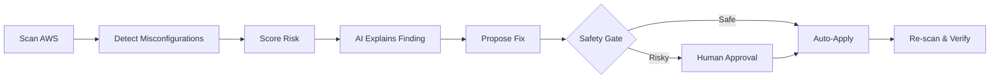
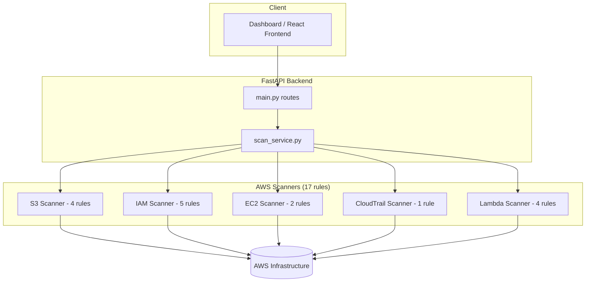

# ☁️ CloudSentinel

**AI-Powered AWS Cloud Security Scanning & Auto-Remediation Platform**

[](https://www.python.org/)
[](https://fastapi.tiangolo.com/)
[](https://aws.amazon.com/)
[](LICENSE)

---

## 📌 Overview

**CloudSentinel** continuously discovers AWS cloud resources, detects security misconfigurations, calculates risk scores, and utilizes AI to explain security findings while offering automated, safety-gated remediation workflows.

The detection core implements **17 security rules** across 5 major AWS services (S3, IAM, EC2, CloudTrail, and Lambda), verified against live AWS environment benchmarks.

---

## 🔄 Pipeline & Architecture



### System Architecture



---

## 🛡️ Security Rules & Coverage

| Service | Rules Implemented | Key Inspections |
|---|:---:|---|
| **S3 Bucket** | 4 rules | Block Public Access, Public bucket detection, Bucket versioning, Encryption at rest |
| **IAM** | 5 rules | Root account MFA, Password policy compliance, User MFA, Wildcard permissions (`*`), Stale access keys |
| **EC2** | 2 rules | Unrestricted SSH/RDP exposure (`0.0.0.0/0`), Unrestricted inbound security groups |
| **CloudTrail** | 1 rule | Logging active status & region-level security coverage |
| **AWS Lambda** | 4 rules | Excessive function permissions, Public function URLs, Secrets in env variables, Missing KMS encryption |

---

## 🧰 Tech Stack

- **Backend Framework**: Python 3.11+, FastAPI
- **AWS SDK**: `boto3` (paginated API calls for scale)
- **Frontend**: React + Vite (Dashboard)
- **Testing**: `pytest`, `unittest.mock`
- **Automation / Lab**: PowerShell scripts (`setup_test_lab.ps1`)

---

## 🚀 Quick Start

### 1. Repository Setup

```bash
# Clone the repository
git clone https://github.com/nayefsiddique-eng/CloudSentinal.git
cd CloudSentinal

# Create and activate virtual environment
python -m venv venv
# On Windows:
.\venv\Scripts\Activate.ps1
# On Linux/macOS:
source venv/bin/activate

# Install dependencies
pip install -r requirements.txt
```

### 2. Environment Configuration

```bash
cp .env.example .env
# Configure database URL (optional for PostgreSQL; default SQLite), AWS keys, and session parameters
```

### 3. Run Backend API

```bash
# Start the FastAPI server (single-instance model for in-memory session store)
uvicorn backend.main:app --reload --port 8000
```
*Access interactive API documentation at `http://127.0.0.1:8000/docs`.*

### 4. Run Frontend Dashboards (Two Implementations Preserved)

CloudSentinel provides two frontend implementations tailored for different operational contexts:

#### Option A: Unified Hardened Frontend (`frontend/`)
Features full session management, Double-Submit CSRF integration, remediation safety gates, structured audit badges, and interactive metrics:
```bash
cd frontend
npm install
npm run dev
# Starts at http://localhost:5173
```

#### Option B: Sireen's Original Frontend (`frontend-sireen/`)
Preserves Sireen's original layout, styling, and navigation workflows:
```bash
cd frontend-sireen
npm install
npm run dev
# Starts at http://localhost:5173 (or next available port)
```

---

## 🔐 Authentication & Session Security Architecture

CloudSentinel implements a defensible dual-path authentication model:

1. **Browser UI Path (Zero Browser Secrets)**:
   - Operators authenticate via `POST /auth/login`.
   - Credentials verified in constant-time using PBKDF2-HMAC-SHA256 (100,000 iterations).
   - Rate limiting: 5 failed attempts per IP within 5 minutes triggers a 15-minute lockout (HTTP 429).
   - Issues cryptographically secure `HttpOnly`, `SameSite=Lax` session cookie (`cloudsentinel_session`).
   - Issues Double-Submit CSRF cookie (`cloudsentinel_csrf`), mirrored into `X-CSRF-Token` header for state-modifying requests (`POST`, `PUT`, `DELETE`).
   - Session fixation protection: pre-existing sessions invalidated on login.
   - **Deployment Model**: The in-memory session store operates in a **single-instance deployment model**. Multi-instance horizontal scaling requires Redis or an external OIDC/OAuth2 Identity Provider (AWS Cognito, Okta).

2. **Server-to-Server (S2S) Path**:
   - Automated runners and CI/CD pipelines supply the `X-API-Key` header.
   - Verified via constant-time comparison (`secrets.compare_digest`).
   - Production startup check: refuses to start in `ENVIRONMENT=production` if `CLOUDSENTINEL_API_KEY` is missing or < 16 characters.

---

## 🧪 Testing & Verification

```bash
# Run complete test suite (mocked AWS responses & adversarial auth tests)
$env:PYTHONPATH="."
pytest tests/ -v

# Run production build and linting for Unified Frontend
cd frontend
npm run lint
npm run build

# Run production build and linting for Sireen's Frontend
cd ../frontend-sireen
npm run lint
npm run build
```

---

## 🌐 API Reference

| Method | Endpoint | Description | Auth Required |
|---|---|---|:---:|
| `GET` | `/health` | Service health status | No |
| `POST` | `/auth/login` | Authenticate operator & set session cookies | No |
| `POST` | `/auth/logout` | Invalidate session & clear cookies | Yes |
| `GET` | `/auth/me` | Current session identity & CSRF token | No |
| `GET` | `/scan` | Executes full audit across all 5 AWS services | No |
| `POST` | `/platform/scans/run` | Triggers a scan, syncs resources, creates remediations | **Session/API Key + CSRF** |
| `GET` | `/platform/findings/` | Returns all findings ordered by ID | No |
| `GET` | `/platform/remediation/` | Enriched remediation tasks & safety tiers | No |
| `PUT` | `/platform/remediation/{id}/approve` | Approve & execute gated cloud remediation | **Session/API Key + CSRF** |
| `PUT` | `/platform/remediation/{id}/reject` | Reject cloud remediation task | **Session/API Key + CSRF** |
| `GET` | `/platform/audit-logs/` | Retrieves audit logs with structured actor attribution | No |
| `POST` | `/platform/audit-logs/` | Manual audit log entry with un-spoofable actor stamping | **Session/API Key + CSRF** |
| `POST` | `/remediation/apply` | Apply remediation via AI pipeline | **Session/API Key + CSRF** |
| `POST` | `/remediation/rollback` | Roll back remediation to snapshot | **Session/API Key + CSRF** |

---

## 📁 Repository Structure

```
CloudSentinel/
├── backend/
│   ├── auth.py               # Dual-path authentication & CSRF engine
│   ├── main.py               # FastAPI entrypoint, middleware, & CORS handling
│   ├── database/             # SQLAlchemy ORM models, DB init, & SQLite fallback
│   ├── routes/               # API route modules (scans, findings, remediation, audit_logs)
│   └── services/
│       ├── scan_service.py   # Scanner orchestration & aggregation engine
│       ├── resource_service.py # Discovered asset inventory sync
│       ├── ai/               # AI explanation, risk scoring, backup, & safety gate
│       └── aws/              # Individual service scanning modules (S3, IAM, EC2, CloudTrail, Lambda)
├── dataset/                  # Labeled secure & vulnerable AWS configurations
├── frontend/                 # Unified Hardened Frontend (AuthContext, CSRF, safety gates)
├── frontend-sireen/          # Sireen's Original Frontend (preserved in clean standalone directory)
├── docs/                     # Architecture, Diagrams, Evaluation, and SRS documentation
├── evaluation/               # Detection and risk evaluation benchmark scripts & dataset
├── scripts/                  # Synthetic dataset generator & PowerShell lab setup
├── tests/                    # 72 unit/integration tests covering auth, DB, scanners, & remediation
└── .env.example              # Sanitized configuration template
```

---

## 🔒 Security Principles & Governance

- **Read-Only Scanner Privilege**: Scanner authentication tokens utilize minimal read-only IAM policies.
- **Human-in-the-Loop Safety Gate**: Destructive auto-remediation actions require human confirmation before execution.
- **Zero Secrets Exfiltration**: Credentials and API keys are stored strictly in local environment variables (`.env`).
