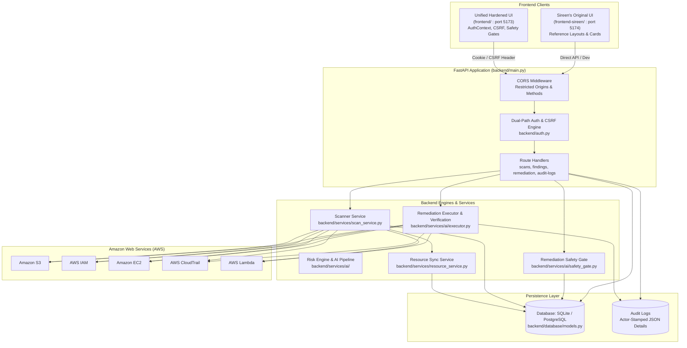
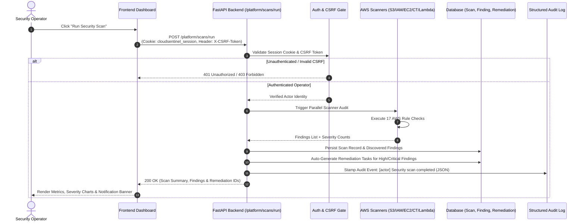
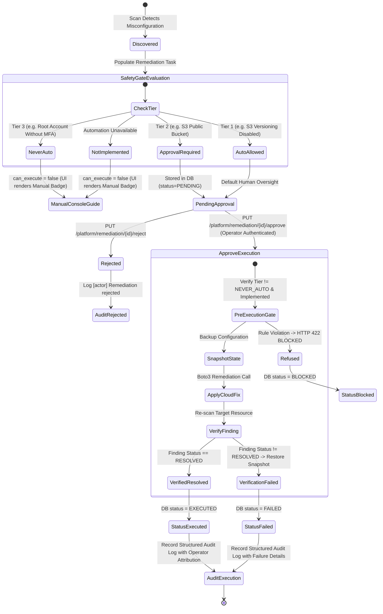
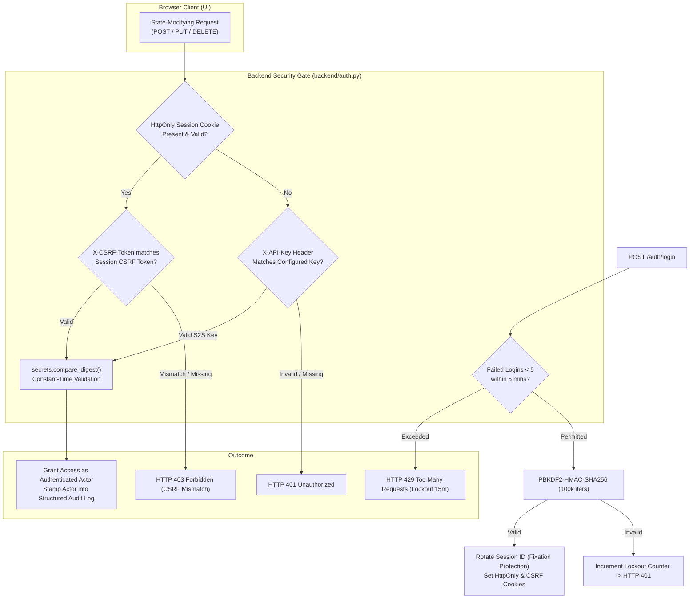

# ☁️ CloudSentinel

**AI-Powered AWS Cloud Security Scanning, Risk Scoring & Safety-Gated Auto-Remediation Platform**

[](https://www.python.org/)
[](https://fastapi.tiangolo.com/)
[](https://react.dev/)
[](https://vitejs.dev/)
[](https://aws.amazon.com/sdk-for-python/)
[]()
[](LICENSE)

---

## 📌 Overview

**CloudSentinel** is a defense-in-depth cloud security platform designed to continuously audit AWS environments, compute contextual risk scores, and present explainable findings with automated, human-in-the-loop remediation workflows.

Key architectural pillars:
- **Comprehensive Detection Core**: 17 detection rules across 5 core AWS services (S3, IAM, EC2, CloudTrail, and Lambda) with paginated `boto3` queries and per-resource exception isolation.
- **Explainable AI Pipeline**: Risk ranking formula and AI explanation service with graceful fallback to deterministic structured templates when LLM services are offline.
- **Authoritative 3-Tier Safety Gate**: Strict enforcement separating safe auto-fixes (`AUTO_ALLOWED`), operator-gated actions (`APPROVAL_REQUIRED`), and high-impact manual fixes (`NEVER_AUTO`), guaranteed at both API and UI layers.
- **Dual-Path Authentication & CSRF Defense**: Zero-browser-secrets session architecture with `HttpOnly`, `SameSite=Lax` cookies, Double-Submit `X-CSRF-Token` headers, brute-force rate-limiting, and constant-time token verification.
- **Dual Frontend Implementations Preserved**: Production Hardened Unified UI (`frontend/`) and Sireen's Original Reference UI (`frontend-sireen/`), each independently buildable and runnable.

---

## 🏛️ System Architecture



---

## 🔄 Scan Lifecycle



---

## 🛡️ Remediation Safety Workflow



---

## 🔐 Authentication & Request Security



---

## 🛡️ Security Rules & Coverage Matrix

| AWS Service | Rule ID | Description | Severity | Safety Tier | Automated Fix |
|---|---|---|:---:|:---:|:---:|
| **S3** | `s3-public-access` | S3 Block Public Access Disabled | **HIGH** | `APPROVAL_REQUIRED` | Enable Block Public Access settings |
| **S3** | `s3-public-bucket` | S3 Bucket Has Public ACL or Policy | **CRITICAL** | `APPROVAL_REQUIRED` | Apply Private ACL |
| **S3** | `s3-versioning` | S3 Bucket Versioning Disabled | **MEDIUM** | `AUTO_ALLOWED` | Enable Bucket Versioning |
| **S3** | `s3-encryption` | S3 Default Server-Side Encryption Disabled | **MEDIUM** | `AUTO_ALLOWED` | Enable AES256 Encryption |
| **IAM** | `iam-root-mfa` | AWS Root Account Does Not Have MFA Enabled | **CRITICAL** | `NEVER_AUTO` | Manual Console Guidance (Security) |
| **IAM** | `iam-password-policy`| Weak Account Password Policy | **MEDIUM** | `AUTO_ALLOWED` | Apply Baseline Password Policy |
| **IAM** | `iam-user-mfa` | IAM User Without MFA Enabled | **HIGH** | `NEVER_AUTO` | Manual Console Guidance |
| **IAM** | `iam-wildcard-policy`| IAM Policy Contains Wildcard (`*`) Action | **CRITICAL** | `APPROVAL_REQUIRED` | Restrict Policy Privileges |
| **IAM** | `iam-stale-keys` | Access Key Not Rotated Within 90 Days | **MEDIUM** | `NEVER_AUTO` | Deactivate/Rotate via Console |
| **EC2** | `ec2-open-ssh` | Security Group Allows Inbound SSH (0.0.0.0/0) | **CRITICAL** | `APPROVAL_REQUIRED` | Revoke Inbound SSH Rule |
| **EC2** | `ec2-open-rdp` | Security Group Allows Inbound RDP (0.0.0.0/0) | **CRITICAL** | `APPROVAL_REQUIRED` | Revoke Inbound RDP Rule |
| **CloudTrail**| `ct-logging` | CloudTrail Is Not Logging Across Regions | **HIGH** | `APPROVAL_REQUIRED` | Start CloudTrail Logging |
| **Lambda** | `lambda-admin-priv` | Lambda Execution Role Has AdministratorAccess | **CRITICAL** | `APPROVAL_REQUIRED` | Detach Admin Role Policy |
| **Lambda** | `lambda-public-url` | Lambda Function URL Has Public Auth (NONE) | **HIGH** | `APPROVAL_REQUIRED` | Restrict URL AuthType to AWS_IAM |
| **Lambda** | `lambda-env-secrets` | Sensitive Credentials/Tokens In Plaintext Env | **HIGH** | `NEVER_AUTO` | Move Secrets to AWS Secrets Manager |
| **Lambda** | `lambda-encryption` | Lambda Function Env Vars Not Encrypted With KMS | **MEDIUM** | `AUTO_ALLOWED` | Configure KMS Encryption |
| **Lambda** | `lambda-dead-letter`| Lambda Function Missing Dead Letter Queue (DLQ) | **LOW** | `AUTO_ALLOWED` | Attach SQS/SNS Dead Letter Queue |

---

## 📁 Repository Structure

```text
CloudSentinel/
├── backend/
│   ├── auth.py                          # Dual-path PBKDF2 authentication, sessions, CSRF, rate-limiting
│   ├── main.py                          # FastAPI application entrypoint, middleware, CORS configuration
│   ├── database/
│   │   ├── database.py                  # Database engine management & SQLite/PostgreSQL resilience
│   │   ├── models.py                    # SQLAlchemy ORM models (Scan, Finding, Remediation, AuditLog)
│   │   └── init_db.py                   # Database table initialization script
│   ├── routes/
│   │   ├── audit_logs.py                # Server-stamped audit log API with actor attribution
│   │   ├── dashboard.py                 # Summary stats, severity counts, and posture calculation
│   │   ├── findings.py                  # Discovered vulnerability listing & filtering
│   │   ├── remediation.py               # Remediation lifecycle & authoritative safety gate API
│   │   ├── resources.py                 # Discovered AWS asset inventory endpoints
│   │   ├── scans.py                     # AWS scan trigger & scan history persistence
│   │   └── security_score.py            # Account compliance posture score endpoints
│   └── services/
│       ├── scan_service.py              # AWS multi-service scanner orchestrator
│       ├── resource_service.py          # Discovered resource synchronization
│       ├── ai/                          # AI engine, risk formula, 3-tier safety gate, rollback pipeline
│       └── aws/                         # Service scanners: S3, IAM, EC2, CloudTrail, Lambda
├── dataset/                             # Ground truth benchmark configurations (secure & vulnerable)
├── frontend/                            # Unified Hardened Frontend (React 19 + Vite + AuthContext)
├── frontend-sireen/                     # Sireen's Original Frontend (preserved independent implementation)
├── docs/                                # Architecture, Diagrams, Evaluation, and SRS specifications
├── evaluation/                          # Automated benchmark evaluation scripts & dataset
├── scripts/                             # Test lab setup and environment automation scripts
├── tests/                               # 72 unit & integration tests (pytest)
├── .env.example                         # Sanitized environment configuration template
├── .gitignore                           # Git ignore rules for build outputs, logs, DBs, and virtualenvs
├── requirements.txt                     # Pinned Python backend dependencies
└── README.md                            # Comprehensive technical documentation
```

---

## 🌐 API Reference

| Method | Endpoint | Description | Auth Required |
|---|---|---|:---:|
| `GET` | `/health` | Service health and operational status | No |
| `POST` | `/auth/login` | Authenticate operator, establish session cookie, return CSRF token | No |
| `POST` | `/auth/logout` | Terminate active session and invalidate auth cookies | Yes |
| `GET` | `/auth/me` | Return active session identity and Double-Submit CSRF token | No |
| `GET` | `/platform/dashboard/` | Return aggregated statistics, score, and recent findings | No |
| `POST` | `/platform/scans/run` | Execute complete AWS security scan across 5 services | **Session/API Key + CSRF** |
| `GET` | `/platform/scans/` | List past scan history and summary counts | No |
| `GET` | `/platform/findings/` | Return all discovered findings ordered by recency | No |
| `GET` | `/platform/findings/{id}` | Return details of a specific finding | No |
| `GET` | `/platform/remediation/` | Enriched remediation tasks with safety tiers and `can_execute` status | No |
| `PUT` | `/platform/remediation/{id}/approve` | Approve & execute safety-gated remediation | **Session/API Key + CSRF** |
| `PUT` | `/platform/remediation/{id}/reject` | Reject remediation and transition to `REJECTED` | **Session/API Key + CSRF** |
| `GET` | `/platform/audit-logs/` | Retrieve security audit events with structured operator attribution | No |
| `POST` | `/platform/audit-logs/` | Create audit log with server-stamped authenticated actor | **Session/API Key + CSRF** |
| `POST` | `/remediation/apply` | Apply remediation via AI pipeline with safety gating | **Session/API Key + CSRF** |
| `POST` | `/remediation/rollback` | Roll back remediation to snapshot | **Session/API Key + CSRF** |

---

## 🚀 Setup & Execution Guide

### 1. Prerequisites
- **Python 3.11+** (Verified on Python 3.11, 3.12, 3.14)
- **Node.js 18+** and **npm**
- **AWS Credentials** configured with read-only audit permissions (or `AWS_MOCK=true` for local development)

### 2. Backend Setup

```powershell
# In repository root:
python -m venv venv
.\venv\Scripts\Activate.ps1

# Install dependencies
pip install -r requirements.txt

# Configure environment
cp .env.example .env
```

Edit `.env` to configure your environment:
```ini
ENVIRONMENT=development
CLOUDSENTINEL_API_KEY=your_secure_development_api_key_32chars
ALLOWED_ORIGINS=http://localhost:5173,http://localhost:5174
```

Start the FastAPI backend:
```powershell
uvicorn backend.main:app --reload --port 8000
```
Interactive Swagger documentation is available at `http://127.0.0.1:8000/docs`.

### 3. Running the Frontends

#### Option A: Unified Hardened Frontend (`frontend/`)
Features complete session state, Double-Submit CSRF headers, defense-in-depth safety gates, operator badges, and inline banners:
```powershell
cd frontend
npm install
npm run dev
# Running on http://localhost:5173
```

To build for production:
```powershell
npm run lint
npm run build
```

#### Option B: Sireen's Original Frontend (`frontend-sireen/`)
Preserves Sireen's original reference layouts, styling, card hierarchies, and assets:
```powershell
cd frontend-sireen
npm install
npm run dev
# Running on http://localhost:5174 (or next available port)
```

To build for production:
```powershell
npm run lint
npm run build
```

---

## 🧪 Testing & Verification

Run the complete 72-test backend verification suite:
```powershell
$env:PYTHONPATH="."
pytest tests/ -v
```

Run test suite categories individually:
```powershell
# Scanner rules & boto3 mock checks (25 tests)
pytest tests/test_scanners.py -v

# AI scoring, risk formula & pipeline fallback (11 tests)
pytest tests/test_ai_pipeline.py -v

# Safety gates, session security, CSRF, rate-limiting & DB resilience (36 tests)
pytest tests/test_remediation_safety_and_db.py -v
```

Run benchmark evaluation against ground truth dataset:
```powershell
python evaluation/evaluate.py
```

---

## 🔒 Cloud Least-Privilege & Production Hardening

1. **IAM Scanner Least-Privilege**: CloudSentinel requires only read-only `SecurityAudit` and `ViewOnlyAccess` policies for scanning. Remediations execute only on explicit approved resources.
2. **Production Startup Verification**: When `ENVIRONMENT=production`, backend refuses to start if `CLOUDSENTINEL_API_KEY` is missing, default demo credentials are used, or wildcard CORS (`*`) origins are configured with credentials enabled.
3. **Session Store Deployment Guidance**: The in-memory session store is intended for single-instance deployments. For multi-replica horizontal clustering, configure a shared Redis store or federate via an enterprise OIDC Identity Provider.
4. **Audit Immutability**: All state mutations stamp the authenticated actor into structured JSON audit records, preventing client-side actor spoofing.

---

## 📄 License

This project is licensed under the MIT License - see the [LICENSE](LICENSE) file for details.
